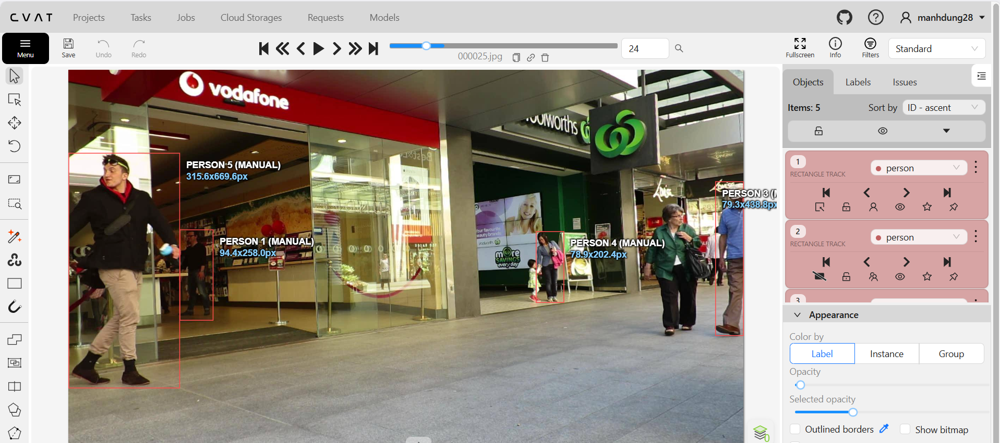
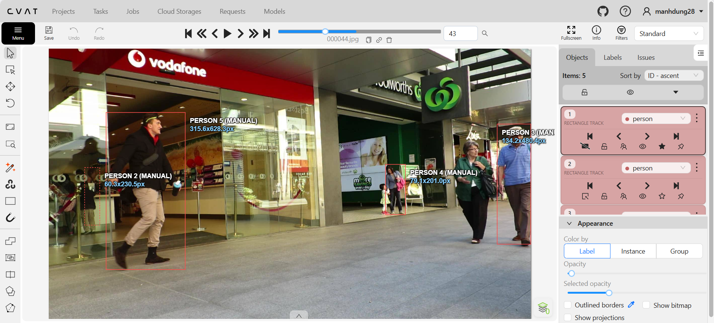
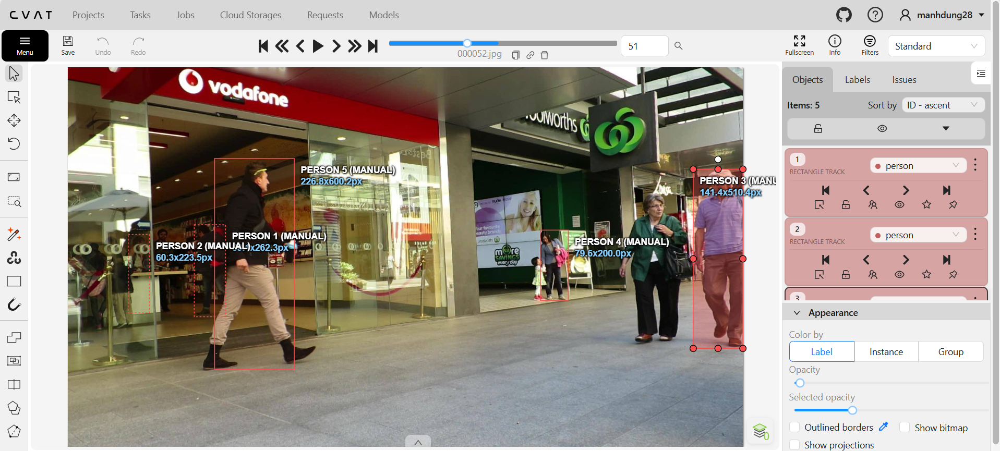

# Báo cáo cá nhân — NguyenManhDung-2A202603197

Đoạn video: MOT17-09, 150 frame (frame 1–150), nguồn MOTChallenge, giấy phép CC BY-NC-SA 3.0.

## 0. Thông tin học viên

- Họ tên: Nguyễn Mạnh Dũng
- MSSV: 2A202603197
- Mã đề (A/B/C): C
- Email: dung28092k3@gmail.com
- Link repository: https://github.com/ngmanhdunggg/K5-L2-DAY05-NguyenManhDung-2A202603197-MOTTracking
- Giờ bắt đầu: 16:30
- Giờ kết thúc: 18:00

## 1. Xem trước đoạn video (CP0)

Tôi bổ sung bảng sau khi gán và xem lại ảnh. Frame theo CVAT (0–149); mốc chuyển động là ước lượng.

| Mã | Frame xuất hiện | Frame cuối thấy được | Rẽ / dừng / đổi tốc độ ở frame | Bị che ở frame | Ghi chú |
|---|---|---|---|---|---|
| P1 | 0 | 149 | 10–20 quay ra cửa; 55–70 đi về phía camera | ≈25–59 (outside: 42–43) | Người đeo kính, áo đen, quần jeans tối trong cửa hàng Vodafone. Bị P5 đi ngang che rồi xuất hiện lại; giữ cùng ID. |
| P2 | 42 | 149 | Chủ yếu đứng tại quầy | 42–99; ≈135–149 | Người sát cửa kính bên trái, theo vòng tròn P2 của đề C. Bắt đầu nhận diện được ở frame 42; cuối đoạn bị nhóm người đi ngang che thêm. |
| P3 | 0 | 149 | Đi về phía camera, không rẽ/dừng rõ | Không bị che | Người đội mũ trắng, áo polo xanh sọc, quần xám ở phía phải. Đi về phía camera nên box lớn dần; đầu đoạn chỉ thấy một phần ở mép ảnh. |
| P4 | 0 | Khoảng 105 | Đứng/di chuyển chậm cạnh em bé | ≈89–105; outside: 106–149 | Người mặc áo khoác xanh/xám, mang túi hồng, đứng cạnh em bé trước Woolworths. Bị người áo xanh lá phía trước che dần; không nhầm với em bé. |
| P5 | 0 | 149 | 0–40 đi sang phải; 40–80 quay chéo xa camera | ≈109–149 (outside: 120–124, 136–148) | Người mặc áo khoác đen, khăn đỏ, quần be, đeo túi chéo. Đi từ trái sang phải rồi xa camera; cuối đoạn bị cặp người tiền cảnh che và lộ lại một phần ở frame 149. |

Lưu ý: cắt mép ảnh không đồng nghĩa với occluded; chỉ bật outside khi không còn thấy phần nào của người.

## 2. Keyframe và thời gian (CP1, CP4)

Số keyframe lấy từ kết quả `src/check_submission.py`.

| Mã | Số keyframe | Keyframe ở frame | Số frame có mặt | Keyframe / 100 frame | Thời gian (phút) | Chỗ khó |
|---|---|---|---|---|---|---|
| P1 | 19 | 0, 10, 20, 25, 30, 36, 40, 44, 50, 60, 70, 80, 90, 100, 110, 120, 130, 140, 149 | 148 | 12,8 | ≈10 | P5 đi ngang che người |
| P2 | 23 | 42, 44, 47, 50, 60, 61, 63, 64, 65, 67, 68, 69, 70, 80, 90, 95, 99, 100, 110, 120, 130, 140, 149 | 108 | 21,3 | ≈10 | Người sau kính, khó xác định toàn thân |
| P3 | 17 | 0, 10, 20, 30, 40, 50, 60, 64, 70, 80, 90, 100, 110, 120, 130, 140, 149 | 150 | 11,3 | ≈10 | Cắt mép phải lúc đầu, box lớn dần |
| P4 | 16 | 0, 10, 11, 12, 13, 14, 15, 16, 27, 37, 47, 57, 67, 77, 87, 89 | 106 | 15,1 | ≈10 | Người tiền cảnh che dần rồi che hết |
| P5 | 18 | 0, 10, 20, 30, 37, 47, 57, 67, 77, 87, 97, 107, 109, 117, 119, 125, 135, 149 | 132 | 13,6 | ≈10 | Đổi hướng, bị che và xuất hiện lại |
| **Tổng** | **93** | — | **644** | **14,4** | **≈50** | — |

Keyframe / 100 frame của cả bài = 93 ÷ 644 × 100 ≈ **14,4**.

P2 có nhiều keyframe nhất (**23**). Người đứng sau kính, bị che nên khó xác định box toàn thân; các keyframe tập trung nhiều ở đoạn 60–70.

## 3. Đoạn bị che (CP2)

Người bị che: **P1**, bị P5 đi ngang che.

| Mốc | Frame |
|---|---:|
| Bắt đầu bị che một phần (bật `occluded`) | 25 |
| Mất hẳn (bật `outside`) | 42 |
| Hiện lại (tắt `outside`) | 44 |
| Thấy rõ trở lại (tắt `occluded`) | 60 |

- Thời gian khuất hẳn: **2 frame (42–43) ≈ 0,067 giây** ở 30 fps.
- Quyết định: **giữ cùng ID**.
- Lý do (trả lời 3 câu: khuất bao lâu so với 60 frame, ngoại hình có khớp, chỗ hiện lại có đúng hướng và tốc độ):

Đoạn khuất hẳn chỉ 2 frame, dưới ngưỡng 60 frame. Khi hiện lại, áo đen, quần jeans tối và vị trí trong cửa hàng khớp với P1 trước đó; chuyển động tiếp nối về phía cửa, không có dấu hiệu đổi sang người khác.

Theo bản xuất, P1 bật occluded ở 25–29, tắt ở 30–35, bật lại ở 36–41 và 44–59; outside ở 42–43.

Ảnh chụp màn hình (nguồn: MOT17, MOTChallenge — Milan et al., 2016):





## 4. Tự review ID (CP3)

Các lỗi dưới đây được ghi từ quá trình sửa trên CVAT và đối chiếu ZIP. Chưa ghi nhận lỗi thuộc lượt review 1 hay 2.

Loại lỗi dùng đúng một trong 7 mã: `id_switch`, `fragmentation`, `lost`, `merge`, `false_track`, `drift`, `flag`.

| Frame | Mã người | Loại lỗi | Mô tả một câu | Phát hiện ở lượt | Đã sửa? |
|---:|---|---|---|---|---|
| 0–63 | P3 | flag | Bật occluded khi người chỉ bị cắt bởi mép phải ảnh. | Đối chiếu ảnh và ZIP | Đã tắt; ZIP mới không còn occluded ở P3 |
| 0–36 | P5 | flag | Bật occluded do người bị cắt bởi mép trái ảnh. | Đối chiếu ảnh và ZIP | Đã tắt trong ZIP mới |
| 41–44 | P1 | flag | Đặt nhầm mốc outside quanh đoạn bị che. | Khi chỉnh đoạn che | Đã sửa; bản xuất chỉ outside ở 42–43, hiện lại ở 44 |

Tổng hợp số lỗi đã ghi nhận theo loại (không phải số lỗi còn sót):

| `id_switch` | `fragmentation` | `lost` | `merge` | `false_track` | `drift` | `flag` |
|---:|---:|---:|---:|---:|---:|---:|
| 0 | 0 | 0 | 0 | 0 | 0 | 3 |

Lỗi nào chỉ lượt 2 (theo cảnh) mới thấy, lượt 1 (theo người) không thấy? Vì sao?

Chưa ghi nhận riêng theo hai lượt; không kết luận lỗi nào chỉ phát hiện ở lượt 2.

## 5. File xuất và kết quả tự kiểm (CP4)

| Kiểm tra | Kết quả |
|---|---|
| Tên file MOT 1.1 | `NguyenManhDung_mot.zip` |
| Tên file CVAT for video 1.1 | `NguyenManhDung_cvat_video.zip` |
| Số track ID khác nhau trong `gt/gt.txt` (phải là 5) | 5 |
| Frame `outside` không có dòng trong `gt.txt` (đúng / sai) | Đúng: đã kiểm tra P1 tại frame CVAT 42–43, không có dòng cho ID tương ứng |
| Job đã completed trên CVAT máy cá nhân | Đã completed |

Dán phần tóm tắt in ra từ `src/check_submission.py`:

```text
=== File MOT 1.1: NguyenManhDung_mot.zip ===
  Số track ID: 5   |   Tổng số box: 644
  [OK]        Đúng 5 track ID.

  Track | Frame có mặt | Số frame | Đoạn vắng (outside)
      1 |   0–149      |      148 | 42–43
      2 |   0–149      |      150 | -
      3 |   0–105      |      106 | -
      4 |   0–149      |      132 | 120–124, 136–148
      5 |  42–149      |      108 | -


=== File CVAT for video 1.1: NguyenManhDung_cvat_video.zip ===

  Track | Nhãn   | Frame thấy | Keyframe | KF/100 frame | Frame occluded | Lần bật outside
      0 | person |        148 |       19 |         12.8 |             27 |               1
              Track 0: keyframe ở frame [0, 10, 20, 25, 30, 36, 40, 44, 50, 60, 70, 80, 90, 100, 110, 120, 130, 140, 149]
      1 | person |        108 |       23 |         21.3 |             58 |               0
              Track 1: keyframe ở frame [42, 44, 47, 50, 60, 61, 63, 64, 65, 67, 68, 69, 70, 80, 90, 95, 99, 100, 110, 120, 130, 140, 149]
      2 | person |        150 |       17 |         11.3 |              0 |               0
              Track 2: keyframe ở frame [0, 10, 20, 30, 40, 50, 60, 64, 70, 80, 90, 100, 110, 120, 130, 140, 149]
      3 | person |        106 |       16 |         15.1 |             17 |               1
              Track 3: keyframe ở frame [0, 10, 11, 12, 13, 14, 15, 16, 27, 37, 47, 57, 67, 77, 87, 89]
      4 | person |        132 |       18 |         13.6 |             23 |               2
              Track 4: keyframe ở frame [0, 10, 20, 30, 37, 47, 57, 67, 77, 87, 97, 107, 109, 117, 119, 125, 135, 149]

  Tổng: 93 keyframe / 644 frame có mặt = 14.4 keyframe / 100 frame
  [OK]        Đọc được 5 track từ annotations.xml.

=== Tóm tắt ===
  Lỗi: 0   |   Cảnh báo: 0
  Đạt. Dán phần tóm tắt này vào báo cáo mục 5.
```

Cả hai ZIP không chứa ảnh gốc. Script kiểm tra cấu trúc và thống kê, không thay thế việc tự review từng box/ID trên video.

## 6. Ba câu kết

1. Nếu được gán lại, bạn sẽ đặt keyframe khác ở đâu? Vì sao?

   Tôi sẽ kiểm tra và bổ sung keyframe nếu cần ở frame 41, ngay trước khi P1 mất hẳn, đồng thời chỉnh kỹ keyframe 44 khi hiện lại để box không trôi quanh đoạn che.

2. Có chỗ nào bạn không chắc "cùng ID hay ID mới"? Bạn đã quyết định và ghi chú thế nào?

   Đoạn P1 bị che ở frame 42–43 cần đối chiếu cùng ID. Tôi giữ ID cũ ở frame 44 vì chỉ khuất 2 frame, ngoại hình và vị trí khớp. Tôi ghi các mốc outside và hiện lại ở mục 3.

3. Một lỗi ID trong job của bạn (nếu không còn sót, chọn lỗi đã sửa) có thể làm xe tự lái dự đoán sai chuyển động của người đó như thế nào? Lỗi đó ảnh hưởng MOTA hay IDF1 nhiều hơn?

   Tôi chưa ghi nhận lỗi đổi ID thực tế; các lỗi đã sửa là cờ occluded. Nếu P1 bị đổi ID sau đoạn che, xe có thể coi đó là người mới, mất lịch sử chuyển động và dự đoán sai hướng hoặc tốc độ. IDF1 phản ánh trực tiếp tính liên tục danh tính; MOTA cũng có thể giảm do ID switch. Mức ảnh hưởng cụ thể cần số liệu đánh giá.

## Bonus (nếu làm)

### B1 — Hai người đi sát

...

### B2 — So cách đặt keyframe

| Cách đặt | Số keyframe | Frame trôi nhất | Ghi chú |
|---|---:|---:|---|
| Đều mỗi 30 frame | | | |
| Theo chỗ đổi hướng | | | |

...

### B3 — So với tracker có sẵn

| Frame | Mã người | Tracker làm gì | Nhãn của bạn | Giải thích (đoán rồi sửa / ghép IoU / box score thấp / ngoại hình) |
|---:|---|---|---|---|
| | | | | |
| | | | | |

## 7. Tài liệu tham khảo và công cụ AI đã dùng

- Tài liệu trong repo: `docs/GUIDELINE.md`, `docs/MOT_FORMAT.md`, `CHECKPOINTS.md`, `SUBMISSION.md`.
- Dữ liệu và ảnh chụp: MOT17, MOTChallenge (Milan et al., 2016), CC BY-NC-SA 3.0.
- ChatGPT/Codex: hỗ trợ cài môi trường, giải thích thao tác CVAT.
